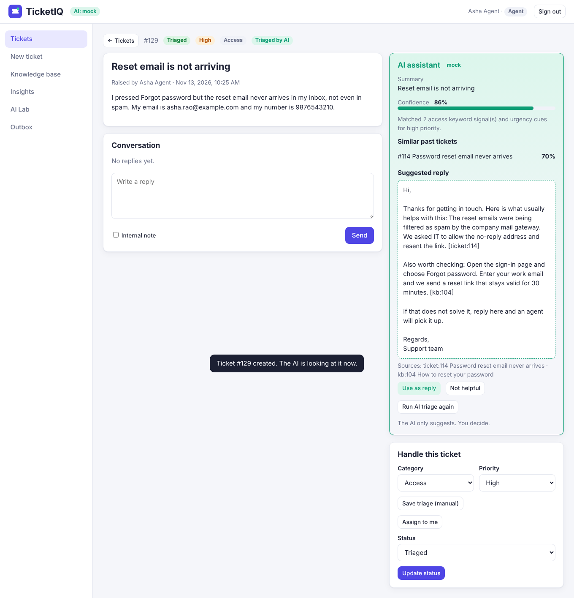

# TicketIQ

I built TicketIQ as an IT help desk where employees can report problems and support teams can manage them through
resolution. I wanted AI to help with the repetitive first pass, while leaving decisions and communication to the people
handling each ticket.



## What you can do

I organized the portal around three roles. Employees can create tickets, follow their status, and reply to support.
Agents can review the queue, assign and triage tickets, use suggested replies, and resolve incidents. Admins can also
manage users and knowledge articles, and control the AI settings.

I added AI to handle some of the first-pass work. For a ticket, it can suggest a category, priority, summary, and
support team, then look for related incidents and knowledge articles to help draft a reply. Staff review the suggestions
before using them. If the AI service is unavailable, the ticket can still be submitted. Ticket text is checked for
personal information before it is sent to an external model.

## Run locally

You need JDK 21 and Maven 3.9 or later. The default setup uses H2 and the built-in mock AI provider, so no database
server or API key is required.

In Windows PowerShell:

```powershell
.\scripts\setup.ps1
.\scripts\run.ps1
```

On macOS or Linux:

```bash
bash scripts/setup.sh
bash scripts/run.sh
```

Open [http://localhost:8080](http://localhost:8080). The setup script creates a local `.env` file. For PostgreSQL,
start the database with `docker compose up -d` and set `SPRING_PROFILES_ACTIVE=postgres` in `.env`.

### Demo accounts

On a fresh demo database, these accounts are seeded for local use. All seeded accounts use the same initial password,
`12345678`; change it from **My profile** after signing in.

- Admin: `admin@ticketiq.local`
- Service desk agent: `agent@ticketiq.local`
- HR systems agent: `agent.hr@ticketiq.local`
- Finance systems agent: `agent.finance@ticketiq.local`
- Application engineering agent: `agent.engineering@ticketiq.local`
- Identity and access agent: `agent.access@ticketiq.local`
- User: `user@ticketiq.local`

Signup supports USER, AGENT, and ADMIN requests. Every new account remains disabled until an administrator approves it
from **Approvals**. Login checks the selected role against the account.

The demo data includes 60 closed/resolved incidents spanning HR, finance, access, endpoint, application, network,
integration, how-to, and product-request cases. Each record includes the owning team, how the case was handled,
completion remarks, resolution time, and safe self-service guidance where appropriate. These records are indexed with
the help articles for RAG. No active incidents are pre-seeded; new tickets are created through the portal.

## AI providers

TicketIQ uses the `mock` provider by default. It runs locally and needs no key. To try another provider, set
`AI_PROVIDER` in `.env`:

- `gemini` uses `GEMINI_API_KEY` and the configured Gemini chat and embedding models.
- `ollama` uses a local Ollama server; pull `llama3.2` and `nomic-embed-text` before starting the app.

The vector index is rebuilt from the database when the app starts. The evaluation report in
[docs/evaluation-report.md](docs/evaluation-report.md) uses the mock provider, so it is not a benchmark of Gemini or
Ollama.

## Try the free preview

The [TicketIQ static demo](https://vamsik2002-ticetiq.static.hf.space) is a quick way to explore the interface. It has
sample tickets, role previews, Insights, and simulated AI suggestions. It is not connected to the Java app: there is no
real sign-in, backend, database, or live AI service, and changes reset when the page reloads. Please do not enter
personal or confidential information.

The [full Java app's Hugging Face Space](https://huggingface.co/spaces/vamsiK2002/TicketIq) is configured to run as a
Docker Space. Hugging Face reports that this account has no `cpu-basic` quota, so the full app is currently paused.

## Tests and project code

Run the test suite with `.\scripts\test.ps1` in PowerShell, or `bash scripts/test.sh` on macOS and Linux. It covers the
AI pipeline, security, validation, and ticket workflows without needing an API key.

The project has two Java modules. `ticketiq-app` contains the Spring Boot API, security, persistence, and browser UI;
`ticketiq-core` contains the ticket analysis, model clients, retrieval, and guardrails. The browser-only preview is in
`hf-static-demo/`. More detail is in [docs/ARCHITECTURE.md](docs/ARCHITECTURE.md),
[docs/API.md](docs/API.md), and [docs/AI-INTEGRATION.md](docs/AI-INTEGRATION.md).

## Before using it beyond a demo

Replace the seeded passwords and default JWT secret, use database migrations instead of `ddl-auto: update`, and choose
a persistent database and vector store. The demo setup is not intended for production.
